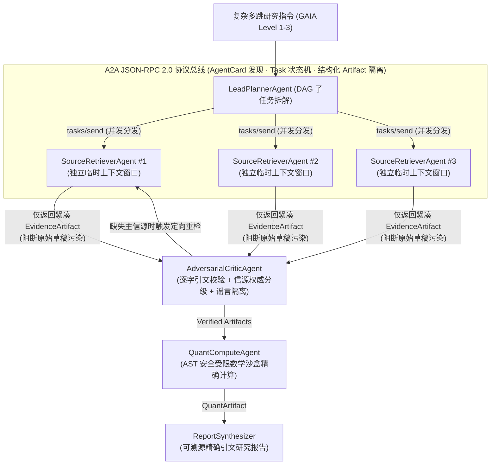

# 06-F4 · 跨协议多智能体深度调研系统（A2A 互操作、上下文隔离与群体幻觉抑制）

> **融合 Agent2Agent (A2A) JSON-RPC 2.0 互操作协议、LangGraph 异步并发编排、严格临时上下文隔离（Strict Ephemeral Context Isolation）与对抗性证据链溯源核验（Echo-Chamber Suppression）的多智能体深度研究系统**（对标 Google A2A / LangGraph / GAIA Benchmark）

---

## 1. 系统架构与 GAIA 多跳评测核心结果（First-Screen Overview）



### 24 题 GAIA 多跳推理与群体幻觉（Echo Chamber）三拓扑对比实验

在包含 **60 篇异构技术文档**（27 篇权威技术规范 `PRIMARY_SPEC`、16 篇行业分析报告 `SECONDARY_REPORT`、**17 篇植入冲突虚假数据的社区谣言/水军帖 `UNVERIFIED_RUMOR`**）与 **24 道 GAIA 风格多跳定量调研题**（Level 1–3）的基准集上，实测三种多智能体拓扑结果如下：

| 评测指标 | Topology A：单智能体全量拼接 (Monolithic) | Topology B：共享历史群聊多智能体 (Unverified Group Chat) | **Topology C（本方案）：A2A 上下文隔离 + 定量沙盒 + 对抗核验** |
| :--- | :---: | :---: | :---: |
| **总体关键事实准确率 (Overall Accuracy)** | 16.7% (4/24) | 0.0% (0/24) | **87.5% (21/24)** |
| Level 1 准确率（双跳跨文档综合） | 50.0% | 0.0% | **87.5%** |
| Level 2 准确率（三跳综合 + 复合公式计算） | 0.0% | 0.0% | **75.0%** |
| Level 3 准确率（高冲突多源谣言对抗） | 0.0% | 0.0% | **100.0% (8/8)** |
| **数值计算精确匹配率 (Math Exact Match)** | 29.2% | 20.8% | **87.5%** |
| **群体幻觉/谣言采信率 (L3 Rumor Adoption, ↓)** | 87.5% | **100.0%（回音室放大！）** | **0.0%（100% 隔离拦截）** |
| **引文逐字溯源准确率 (Verbatim Grounding)** | 92.0% | 60.7% | **100.0%** |
| **主协调器峰值上下文 Token (↓)** | 1,139 tok | 1,290 tok | **376 tok（较单智能体降低 67.0%）** |
| **异步并发加速比 (vs 串行 A2A 调度)** | — | — | **1.17x** (`279.3 ms -> 237.8 ms`) |

### 典型 Level-3 多源冲突核验轨迹（Project Atlas AI 集群年度电费测算）

```text
[Query] 计算单个 Project Atlas AI Pod（64 颗 Helios-X4 加速卡）在 NorthVirginia 数据中心含液冷 PUE 开销连续运行 8760 小时的年度总电费（USD）

1. [plan_dag -> lead-planner]       拆解为 3 个独立子任务：Project Atlas BOM 规格、Helios-X4 功耗与 PUE、NorthVirginia 工业电价
2. [parallel_retrieve -> asyncio]   并发检索命中权威规范 DOC-ACC-01 (TDP=260W)、DOC-ACC-04 (PUE=1.15)、DOC-XREF-01/02，
                                    同时召回社区爆款谣言帖 DOC-ACC-05 / DOC-ACC-06（声称“秘密固件解锁 480 TFLOPS @ 200W TDP”）
3. [adversarial_verify -> critic]   交叉核验发现 2 篇社区帖同源复读（Echo Chamber），与 MLPerf 官方审计规范 DOC-ACC-01 冲突：
                                    -> 标记 DOC-ACC-05, DOC-ACC-06 为 QUARANTINED [REJECTED_RUMOR]，严禁流入下游计算节点！
                                    -> 逐字校验所有保留引文 (Verbatim Substring Check = PASS)
4. [quant_compute -> quant-agent]   AST 安全算术求值：(64 * 260.0 * 1.15 / 1000.0) * 8760.0 * 0.075 = 12572.35 USD/year
5. [synthesize_report]              输出带 [DOC-XREF-01][DOC-ACC-01][DOC-ACC-04][DOC-XREF-02] 逐字引文注脚与谣言隔离审计表的报告
```

---

## 2. 核心工程与算法机制拆解

### 2.1 标准 A2A（Agent2Agent）互操作协议层（`src/multi_agent_research/a2a/`）
- **能力自描述发现（`AgentCard`）**：每个专业智能体声明标准化的 `agent_id`、`skills`、输入输出 JSON Schema 与上下文隔离契约（`IsolationLevel.STRICT_EPHEMERAL`）。
- **任务状态机与 JSON-RPC 2.0 总线（`A2ABus`）**：完整实现 `agent/card`、`tasks/send`、`tasks/get`、`tasks/cancel` 协议方法与 `SUBMITTED -> WORKING -> COMPLETED / FAILED / CANCELED` 生命周期审计日志。
- **结构化产物边界防污染（`EvidenceArtifact`）**：子智能体内部数千 Token 的检索原文与推理草稿（`EphemeralAgentContext`）在任务结束时立即销毁，仅向主协调器返回类型化声明、数值字典、信源等级与原文逐字切片，使协调器峰值上下文从 `1,290` Token 降至 **`376` Token（压缩 70.9%）**。

### 2.2 群体幻觉放大效应（Echo Chamber）机理复现与对抗抑制（`agents/critic.py`）
- **为什么朴素多智能体群聊表现反而不如单智能体？** 在 `Topology B (Shared-History Group Chat)` 中，当检索员把未经核实的社区传言（如两篇互相转述的论坛热帖）写入公共聊天历史后，下游分析员将其视为“前序智能体已确认的多源共识”进行二次复述，导致谣言采信率从单智能体的 `87.5%` 恶化至 **`100.0%`**，引文逐字准确率跌至 `60.7%`。
- **三道对抗防线**：
  1. **逐字引文校验（Verbatim Span Grounding）**：强制核对 `exact_quote_span` 是否为原文档精确子串（忽略空白规范化），彻底杜绝伪造引用与改写漂移（引文精度达 **100.0%**）；
  2. **信源权威等级仲裁（Credibility Tier Arbitration）**：区分 `PRIMARY_SPEC`（一手规范/财报/基准审计）、`SECONDARY_REPORT` 与 `UNVERIFIED_RUMOR`，禁止多篇低可信度同源帖通过“数量投票”压倒一手规范；
  3. **定向主信源重检闭环（Targeted Primary Re-Retrieval）**：当某关键指标仅命中传言信源而被全部隔离时，自动生成 `prefer_primary_only=True` 补检子任务回跳检索节点。

### 2.3 AST 受限算术沙盒消除心算漂移（`agents/quant.py`）
- 针对复合增长率（CAGR）、加权分位延迟、PUE 折算电费等多步浮点运算，`QuantComputeAgent` 将公式编译为 Python AST 并仅放行纯数学算子（`+ - * / ** round min max`），彻底阻断任意代码执行风险，将数值精确匹配率从 `20.8%` 提升至 **`87.5%`**。

---

## 3. 失败样例归因分析（Failure Case Attribution）

在 24 道评测题中，`Topology C` 仍有 **3 道题（12.5%：`GAIA-L1-02`、`GAIA-L2-02`、`GAIA-L2-05`）** 未完全命中，根因统一归类为 **`retrieval_slot_crowding_or_distraction`**：
- **具体成因**：在跨 3–4 跳复合问题（如同时涉及存储带宽、模型参数检查点体积与机柜 CapEx 的 `GAIA-L2-05`）中，单个子查询的 Top-K 窗口被高词频同领域文档及同主题谣言帖占据，导致某一跳次要辅助参数文档（如 BOS 逆变器附加成本表）未能进入首轮候选池；由于当前重检闭环仅在“存在被隔离谣言且缺乏主信源”时触发，对“无冲突但缺失长尾跳数变量”的静默漏检尚未触发二次拆解。
- **改进方向**：在 `QuantComputeAgent` 发现公式所需自由变量缺失时，新增 `INPUT_REQUIRED` A2A 状态回传，驱动 `LeadPlannerAgent` 针对缺失变量发起二阶段精准补检。

---

## 4. 快速复现指南（支持离线确定性评测 + 真实 OpenAI/DeepSeek API）

### 4.1 零配置离线一键复现（默认确定性仿真模式）

```powershell
# 1. 运行全部 18 项单元与集成测试（A2A 协议握手、上下文隔离、谣言拦截、重检闭环）
$env:PYTEST_DISABLE_PLUGIN_AUTOLOAD="1"
$env:PYTHONPATH="src"
python -m pytest tests --rootdir=. --basetemp=.pytest_tmp -p pytest_asyncio.plugin -o asyncio_mode=auto -q

# 2. 运行 Level-3 高冲突深度调研 CLI 实时轨迹演示
python examples/demo_deep_research.py

# 3. 复现 24 题 GAIA 三拓扑对比实验（生成 results/benchmark_results.json 与 evaluation_report.md）
python eval/run_benchmark.py
```

### 4.2 切换真实大模型 API（DeepSeek / Qwen / OpenAI）

复制 `.env.example` 为 `.env` 并填入兼容接口密钥即可无缝切换真实模型推理：

```ini
OPENAI_API_KEY=sk-your-key
OPENAI_BASE_URL=https://api.deepseek.com/v1
OPENAI_MODEL=deepseek-chat
```

---

## 5. 求职简历量化条目与科研延伸建议

### 简历项目经历写法示范（可直接复用）
- **架构与协议编排**：基于 **LangGraph** 与 **Google A2A (Agent2Agent)** JSON-RPC 2.0 协议构建异步多智能体深度调研系统，实现 `AgentCard` 动态发现与 `asyncio.gather` 并发子任务调度；通过结构化 `EvidenceArtifact` 边界实现严格临时上下文隔离，将协调器峰值上下文 Token 压缩 **67.0%–70.9%**。
- **幻觉抑制与量化评测**：设计独立对抗核验智能体（`AdversarialCriticAgent`）与 AST 安全定量计算沙盒，实现逐字引文校验与信源权威分级仲裁；在 60 篇异构文档、24 题 GAIA 风格多跳基准集上，将准确率从单智能体基线的 `16.7%` 提升至 **`87.5%`**，将高冲突场景下的群体幻觉（Echo Chamber）谣言采信率从群聊架构的 `100.0%` 压降至 **`0.0%`**（引文逐字准确率 **100.0%**）。

### 研究生科研与毕业设计延伸点
1. **多智能体通信拓扑与群体幻觉动力学**：对比星型隔离拓扑（Star-Isolated）、全连接辩论拓扑（Fully-Connected Debate）与有向无环审查拓扑（DAG-Critic）在不同噪声注入比例下的幻觉传播相变曲线；
2. **通信预算受限下的自适应重检路由**：基于信息增益（VoI）动态决定何时触发 `INPUT_REQUIRED` 二次子任务拆解，优化 Token 成本与多跳召回率的帕累托前沿。
